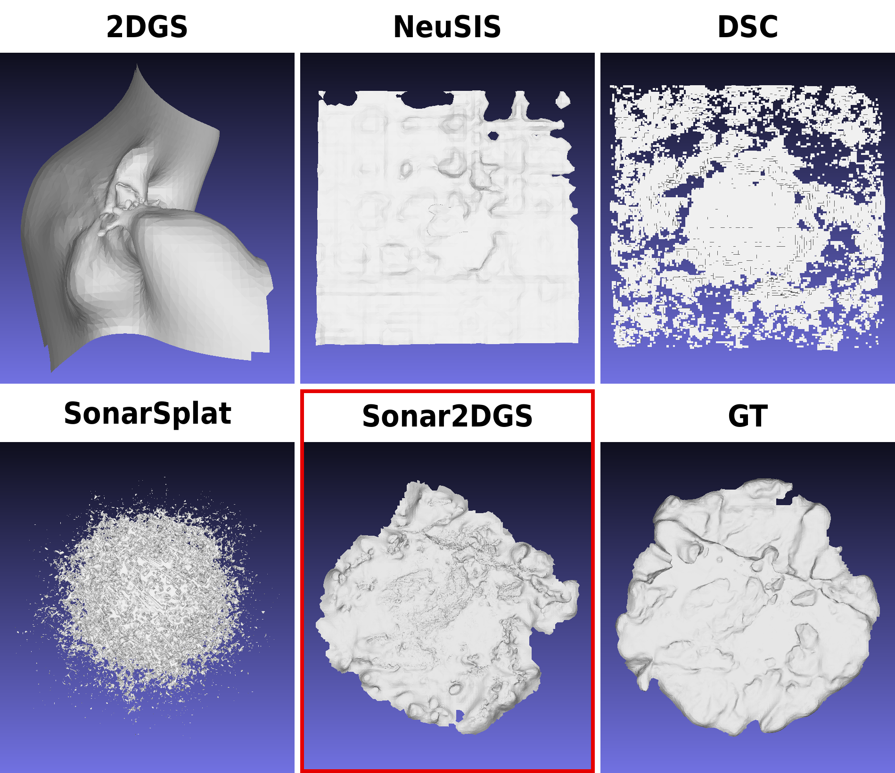
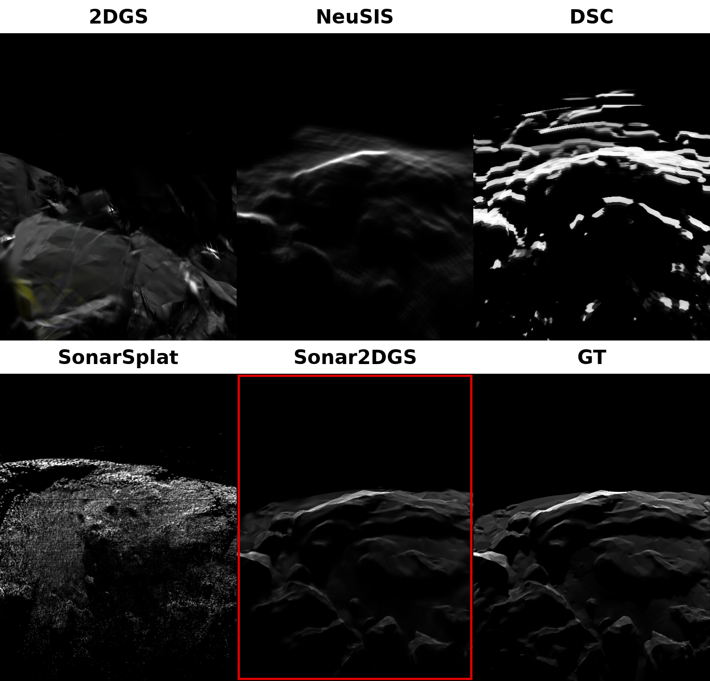

# Sonar2DGS

**Differentiable 2D Gaussian Splatting for Forward-Looking Sonar 3D Reconstruction**

[Project Repository](https://github.com/OneThree123/Sonar2DGS) · **Preprint: coming soon**

Sonar2DGS is a scene-specific 3D reconstruction framework for forward-looking imaging sonar. It represents scenes with planar 2D Gaussian surfels and optimizes them using a differentiable sonar renderer.

## Features

- Models surface-normal-dependent acoustic reflection.
- Performs ray-wise occlusion computation and pixel-wise echo accumulation.
- Optimizes sonar image losses together with geometry regularization and Gaussian density control.
- Supports model training, rendering, and mesh extraction.

## Results

### Geometry reconstruction



### Sonar rendering



## Environment

Tested with:

- Linux, NVIDIA GPU, CUDA 12.8-compatible PyTorch
- Python 3.10
- PyTorch 2.10, Open3D 0.18, NumPy 1.26

Create the environment and compile the CUDA extensions:

```bash
conda env create --file environment.yml
conda activate surfel_splatting

pip install submodules/diff-surfel-rasterization
pip install submodules/simple-knn

export LD_LIBRARY_PATH=$CONDA_PREFIX/lib:$LD_LIBRARY_PATH
```

## Usage

Prepare a forward-looking sonar dataset and provide its path with `-s`.

```bash
# Train
python train.py -s <dataset_path> -m <output_path>

# View a trained model
python view.py -s <dataset_path> -m <output_path>
```

Run `python train.py --help` to view all training options.

## Citation

The manuscript is currently in preprint preparation. Please cite the following entry for now:

```bibtex
@article{zhao2026sonar2dgs,
  title={Sonar2DGS: Differentiable 2D Gaussian Splatting for Forward-Looking Sonar 3D Reconstruction},
  author={Zhao, Yibo and Wen, Huafeng and Wang, Xin and Li, Jiangang},
  note={Preprint in preparation},
  year={2026}
}
```

## Acknowledgements

This project builds on [2D Gaussian Splatting](https://github.com/hbb1/2d-gaussian-splatting) and its open-source dependencies.
